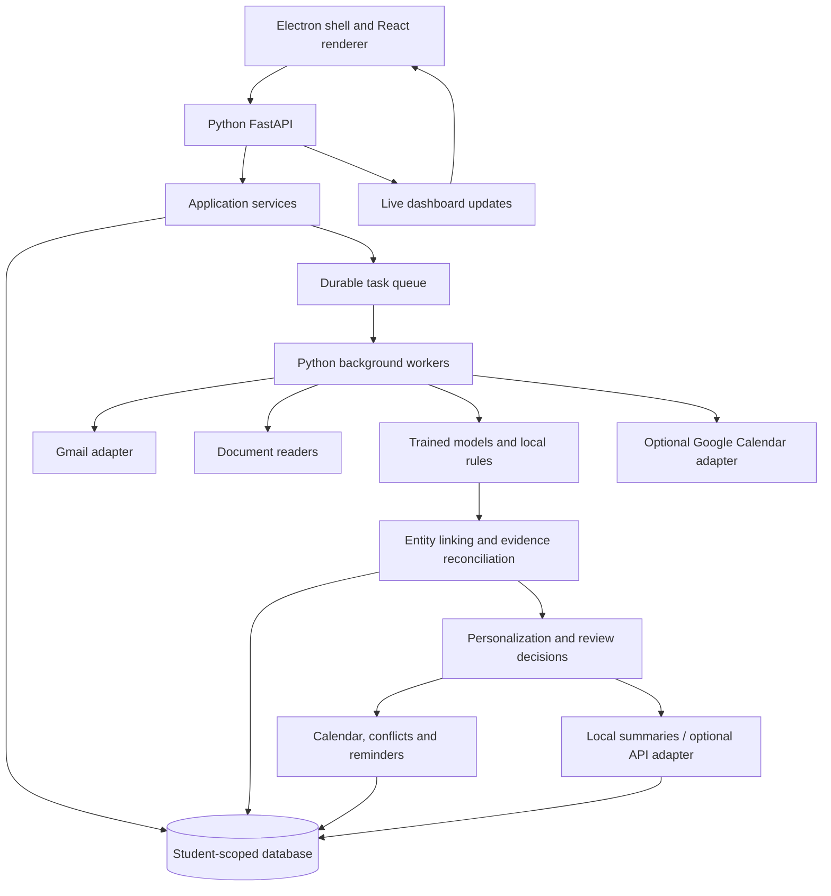

# Campus Mail Analyser — architecture and phased implementation plan

Status: agreed requirements consolidated into an implementation design. No Gmail access, dataset collection, application implementation, or deployment has occurred. Gmail connection and dataset research are deferred until implementation.

## 1. Product definition and agreed behavior

A multi-user academic assistant that converts authorized Gmail messages, conversations, and readable attachments into personalized academic records, actions, a calendar, reminders, and evidence-backed summaries.

- Each student has an isolated account/profile, Gmail connection, academic identity, preferences, resources, marks, and calendar.
- Bootstrap from the latest 50 inbox messages, configurable to 30–50 or a user-selected range. Fetch older context when needed and permitted. A recent-message bootstrap is not a guarantee of complete deadline coverage.
- Read Gmail without requesting send/delete permissions. Analyze complete relevant threads, including the student's sent replies when within the authorized scope. Retain links to the source conversations.
- Infer university, program, semester, courses, batch, section, lab group, and roll number. Cross-check evidence and ask about ambiguity. A name or roll number in a forwarded message or class results table alone is not identity proof.
- Extract multiple events, meetings, assignments, deadlines, and requests from one message. Link later updates, cancellations, and corrections to existing records.
- Assign high/medium/low importance automatically. Track relevance, importance, urgency, and participation separately. Explicit user overrides win and contribute to personal learning.
- Automatically calendar clear enrolled-course obligations with sufficiently resolved dates. Ask about optional participation and uncertain obligations. Incomplete mandatory items still appear prominently but require time clarification before precise calendar placement.
- Provide an in-app calendar; optional Google Calendar synchronization and external-calendar conflict checks come later.
- Detect conflicts with timetable occurrences, confirmed commitments, and authorized external calendars. Suggest alternatives; apply only after approval. Never alter an official exam, class, or assignment deadline to resolve a conflict.
- Extract readable supported attachments. Retain unreadable resources with a visible analysis status. Drive URLs remain links; no Drive content retrieval in the agreed release.
- Associate useful attachments and URLs across messages. Surface important resources automatically; ask about uncertain links. Distinguish exact duplicates, similar documents, and superseded versions.
- Flag likely replies needed, with message evidence and a Gmail link. No reply drafts or sending in the agreed first version.
- Import externally produced timetable and holiday JSON using supplied prompts, validation, preview, and confirmation. Resolve combined-batch schedules before producing personalized JSON.
- Maintain a private marks tracker; do not guess identity matches, grading weights, totals, missing marks, or assessment equivalences.
- Provide in-app reminders, a daily briefing, change-driven dashboard summaries, and an on-demand weekly view. Other delivery channels remain extension points.
- Group clarification questions in a review queue. Ask a few at a time; urgent uncertainty is highlighted on the dashboard. Skipping is unresolved, not acceptance.
- Every explicit acceptance/correction is a personal feedback event. Students' data and feedback never train the shared model. Shared training uses only the separately designated project dataset and suitable public datasets.
- Most processing is Python and local. Self-trained models are an evaluated project core. APIs are optional for advanced language generation or interpretation and are separately identified.

## 2. Architecture and deployment

Use a modular monolith: one Python codebase with bounded modules, one API process, and separate background consumers. This provides clear ownership and extension points without requiring microservices.



### Desktop-local mode: default implementation

- Electron starts a packaged Python API and worker process, supervises health, and provides a polished renderer.
- API listens only on loopback with a per-launch secret/session bootstrap and restrictive allowed origins. Bind to an ephemeral or configurable port.
- SQLite stores application data; a separate SQLite-backed Huey queue stores jobs. Use transactional writes, bounded concurrency, migrations, and lock/busy handling.
- Files and model artifacts stay on the student's machine. Tokens use an OS credential vault; never persist them in plain application tables or expose them to renderer code.
- Support multiple isolated signed-in profiles. Account switching never reuses another student's cache or authorization context. Tenant scoping is enforced in backend queries, attachment access, and jobs.
- Desktop-local mode supports multiple students/accounts but does not imply a centrally shared hosted service. Local profiles do not protect data from an administrator of the same operating-system account; use separate OS accounts where that boundary matters.
- While running, the backend syncs and creates reminders. An optional tray/background mode can keep it running after the window closes. If all processes are stopped, catch up on restart; no promise of live delivery while the computer is off.

### Hosted mode: later deployment of the same core

- Electron communicates with an authenticated HTTPS Python API.
- PostgreSQL replaces SQLite; Redis-backed Huey replaces the local queue; private object storage replaces filesystem resource storage.
- Workers perform local Python processing on the deployment server. Hosted local NLP means no external model provider; it does not mean processing on each student's device.
- Add server-side session authentication, rate limits, operational metrics, encrypted token storage, and tenant-isolation integration tests before enabling this mode.
- Choose OAuth client/redirect configuration appropriate to the deployment. Desktop uses the system browser and desktop flow; hosted mode uses the server web flow. Gmail authorization is separate from application login.

## 3. Recommended stack

| Layer | Selection | Responsibility |
|---|---|---|
| Domain/application | Python | All academic logic and processing |
| API | FastAPI + Pydantic | Typed requests, validation, API contracts |
| Persistence | SQLAlchemy + Alembic | Models, transactions, migrations |
| Desktop database | SQLite | Local student-scoped data |
| Hosted database | PostgreSQL | Concurrent hosted accounts |
| Jobs | Huey: SQLite locally, Redis when hosted | Scheduled jobs, retries, worker execution |
| Shared models | scikit-learn | TF-IDF, MultinomialNB, LinearSVC; optional personal online model |
| Text processing | Regex, dateparser, lightweight sentence segmentation | Dates, rules, action spans |
| PDF | PyMuPDF; optional pdfplumber for tables | Readable PDF text and table-oriented extraction |
| Other readers | Python stdlib, python-docx, openpyxl | TXT/CSV/HTML/DOCX/XLSX readers as added |
| Desktop shell | Electron | Process supervision, file picker, system-browser links |
| Renderer | React + TypeScript + CSS | Presentation and interaction only |
| Tests | pytest; selected desktop end-to-end tests | NLP fixtures, integration and isolation |
| Optional generation | Provider-independent Python adapter | Enhanced summaries with local fallback |

Pin tested stable releases during implementation. Do not introduce an API model requirement into the application's baseline behavior. Streamlit is useful for experimental model inspection, but the final UI follows the requested Electron design.

## 4. Module boundaries and extension contracts

Python modules own the following responsibilities:

1. accounts: student accounts, active profile, consent boundaries, timezone, credentials references.
2. ingestion: Gmail paging, MIME decoding, thread retrieval, history checkpoints, older-context queries.
3. documents: content-type validation, text/table extraction, resource hashes, readability status.
4. identity: field-level profile inference, course aliases, evidence, confirmed facts, temporal validity.
5. nlp: feature pipelines, category prediction, sentence/date/action extraction, optional API interface.
6. knowledge: canonical entities, typed relationships, candidate matching, revisions, field provenance.
7. personalization: eligibility, relevance, importance, feedback, private preference state.
8. review: unresolved questions, alternatives, user answers, dependencies, dismissal/defer states.
9. calendar: participation, schedule materialization, external mappings, timetable/holiday import.
10. planning: overlap detection, deadline clustering, flexible-session proposals.
11. conversations: request ownership, outstanding replies, waiting-for status and resolution.
12. grades: identity-matched results, course/assessment mapping, revisions and known grading schemes.
13. notifications: due reminders, deduplication, delivery adapters and catch-up.
14. summaries: daily/weekly snapshots, change-driven refresh, source-linked output.
15. training: project dataset curation, model fitting, evaluation and artifact registry.

Define small contracts: EmailProvider, DocumentReader, Classifier, Extractor, ResourceLinker, CalendarProvider, NotificationChannel, Summarizer, BlobStore, and JobQueue. Add a new feature through an adapter or module rather than adding unrelated logic to an ingestion function.

The synchronous core pipeline accepts data structures and returns typed candidates. API endpoints and jobs call it; the domain code does not import Electron or depend on an HTTP request.

## 5. Processing lifecycle

1. Authorize account and processing filters.
2. Retrieve latest inbox message IDs and message content. Persist a sync boundary and reconcile changes occurring during bootstrap so no intervening updates are lost.
3. Retrieve relevant thread context and attachments within authorized scope. Report when filters prevent complete context.
4. Canonicalize text while retaining the original MIME/source, HTML/plain variants, attachment page/sheet references, and offset maps.
5. Separate newly authored text from quotations and signatures where possible. Preserve quoted content for context but avoid creating duplicate actions from it.
6. Run the category pipeline and local candidate extractors independently; no single-category decision blocks other entities in the message.
7. Store candidates with field-level evidence, ambiguity, extractor/model versions, and analysis timestamp.
8. Resolve entities against existing course, event, task, document, thread, and assessment records.
9. Reconcile updates. Explicit correction/cancellation language plus matching entity context is stronger than mere message recency. Conflicting evidence generates review.
10. Apply personal relevance, importance, participation, and ambiguity policies.
11. Commit records and durable downstream-work requests together, using a database outbox for work that must survive process crashes.
12. Recompute affected calendar items, reminders, reply flags, and summaries. Push versioned updates to the UI.

Deduplication keys include student/account ID and Gmail message ID; attachment identity includes a content hash within the student scope. Analysis jobs have input hashes and analyzer versions. Retries must not duplicate records, calendar entries, marks, or notifications. A job ledger and periodic reconciliation handle abandoned/failed jobs.

Gmail history checkpoints advance only after durable ingestion. Expired history checkpoints trigger a bounded reconciliation/full resync within configured scope. Do not download the entire mailbox accidentally because a cursor expired.

## 6. Knowledge and memory model

Start with a relational knowledge model; no dedicated graph database is required.

```text
Student --enrolled_in--> Course
Message --belongs_to--> Thread
Message --announces/updates/cancels--> Event or Assignment
Resource --supports/replaces--> Event, Assignment, Course or Resource
AssessmentResult --for_student/in_course--> Student and Course
TimetableSession --for_course/for_batch--> Course and Batch
Feedback --corrects/confirms--> Field or Decision
```

Use ordinary tables and explicit typed link tables with foreign keys where the relationship is known. Avoid a universal unvalidated JSON graph. A constrained relationship table may support additional evidence links, but validate source/target type and tenant ownership.

Memory consists of confirmed/inferred profile facts, canonical academic entities, relationships, and personal preference history. Text retrieval is a separate concern. Start with exact identifiers, course aliases, normalized titles, and TF-IDF similarity. Add embeddings only after measuring missed cross-message links; vectors are not the authoritative fact store.

Core tables:

| Group | Tables |
|---|---|
| Accounts/profile | users, email_accounts, profile_facts, courses, enrollments |
| Sources | threads, messages, resources, resource_versions, extracted_documents |
| Academic records | events, assignments, action_items, assessment_results |
| Evidence/reconciliation | evidence_spans, field_assertions, entity_links, record_revisions |
| Calendar | calendar_items, participation_decisions, timetable_rules, holidays, schedule_exceptions, external_event_mappings |
| Interaction | review_questions, feedback_events, personal_preferences, personal_model_versions |
| Background work | sync_states, analysis_runs, job_ledger, outbox_events |
| Output | reminders, notifications, briefing_snapshots |
| Research | dataset_manifests, training_runs, model_artifacts, evaluation_results |

Every student-owned row has an owner ID; compound constraints and foreign keys prevent cross-account relationships. Artifact/data filenames do not determine authorization. Shared project research artifacts live separately from operational student data.

Each extracted field records value, source evidence, validity period where relevant, model/rule origin, and status: inferred, corroborated, user-confirmed, conflicting, or unavailable. Numerical probabilities appear only when calibrated and evaluated. Confirmed user edits survive re-analysis until the user changes them or a material conflict is raised.

Example assignment record:

```json
{
  "id": "assignment_001",
  "owner_id": "student_001",
  "course_id": "course_nlp",
  "title": "NLP assignment 2",
  "description": "Implement and compare the specified classifiers",
  "due_at": "2026-11-04T17:00:00+05:30",
  "date_precision": "datetime",
  "importance": "high",
  "status": "open",
  "resources": ["resource_pdf_001", "resource_submission_link_001"],
  "evidence_ids": ["evidence_001", "evidence_002"],
  "revision": 2
}
```

Dates without a time remain date-only, with precision explicitly represented. Do not silently manufacture 23:59 deadlines. Store timezone-aware instants and original wording; timetable recurrence uses the student's configured local timezone.

## 7. Local NLP and self-trained models

### Evaluated core

Train TF-IDF + Multinomial Naive Bayes and TF-IDF + Linear SVM on identical grouped splits. Include a majority-class baseline. Save the vectorizer and classifier together in a pipeline, with taxonomy, parameters, dependency versions, dataset version and validation metrics.

Retain the original comparison methodology. Expand the category taxonomy for the application: examinations, assignments, workshops/events, placements, scholarships, administration, course materials, and nonacademic/other. Annotate this proposal change explicitly; if data is insufficient for expanded categories, report a five-category academic benchmark separately and use rules for additional types. An academic relevance gate needs negative examples; a five-category college-only dataset cannot demonstrate unrelated-email filtering.

Classification assists extraction and prioritization; it does not reduce a multi-topic email to one event or one action.

### Local extraction

- Dates: supported patterns plus normalization, role assignment near each mention, reference dates for relative wording, explicit ambiguity for missing year/time.
- Actions: instruction patterns, modal verbs, actor/recipient clues, negation and completed-action exclusions.
- Courses/identity: course codes, aliases, enrollment evidence, salutation/signature context and timetable confirmation.
- Marks: table/text row matching, exact normalized roll-number matching preserving leading zeros, assessment/course identification, grading-scheme rules only when known.
- Reply-needed: questions/direct requests, recipient ownership, outstanding thread state, latest author, subsequent response and explicit resolution. Broadcast rhetorical questions do not automatically become obligations.
- Resources: URL extraction, same-thread association, exact IDs and course context, semantic/text similarity for candidate matches.

Initial readers: plain text, CSV, HTML text, text-based PDFs. Add DOCX/XLSX using reader adapters. Images and scanned PDFs are unreadable until an optional local OCR reader is implemented and evaluated. Password-protected, corrupt, or unsupported files remain accessible resources with a clear status.

### API enhancement

Optional API summaries receive selected structured facts/evidence, not automatically the whole inbox. Validate outputs against schemas and supplied IDs. Generated prose cannot invent dates, marks, participation, or mutations. Source content is data, never an instruction to invoke tools. API failures fall back to local templates. Feature-level consent is separate from Gmail read authorization.

## 8. Personal learning and decision policies

Separate dimensions:

- Relevance: applicable, potentially relevant, unrelated, uncertain.
- Importance: high, medium, low.
- Urgency: derived from time remaining and required action.
- Participation: mandatory, interested, confirmed, declined, unknown.

Personal learning has two stages. First, deterministic preference memory immediately records choices such as topic interest, sender preference, optional-event defaults, and field corrections. Later, when enough personal examples exist, train a lightweight private relevance/importance model using scikit-learn. Until then, avoid pretending that a few clicks support a reliable classifier.

Each feedback event stores the item/field, prior prediction, explicit answer, context features, scope, timestamp, and originating record revision. A confirmation of a date is not a label saying all similar events are interesting. A declined event is not necessarily low importance. Deduplicate repeated clicks and make feedback reversible.

Corrections receive stronger weight than acceptance. Do not treat inactivity as acceptance. Allow exact-item overrides, topic/sender-level preferences, semester expiry, and resets. Explicit rejection overrides learned enthusiasm for that item; clear compulsory obligations remain visible even if the student dislikes the topic. Feedback remains personal and never updates shared models.

Calendar policy: resolved compulsory enrolled-course obligations enter automatically; optional events require interest/participation confirmation; unknown applicability/time creates review. Date-only deadlines appear as due markers. Registration interest does not imply successful registration.

## 9. Resources, conversation state, marks and conflict behavior

### Resource linking

Compute exact byte hashes, normalized-text hashes, document titles and course identifiers. Exact duplication can be decided automatically. Near-duplicate similarity suggests redundancy but does not prove it; changed deadline/assessment content can make a similar file crucial. Mark a resource superseded only with corroborating update evidence; preserve prior versions and original attachments.

URLs are resources with roles such as meeting, registration, submission, reference and Drive document. Opening links uses the system browser. The agreed release extracts and associates links; Drive retrieval is deferred. Arbitrary web fetching is a separate future adapter, not silently enabled.

### Conversations

Maintain request states: needs_reply, waiting_for_other, resolved, uncertain. Track each request separately; one reply may resolve one question while another remains outstanding. Re-evaluate flags when thread messages arrive. A student can mark resolved or false-positive; explanations show the relevant source message.

### Marks

Maintain semester/course/assessment records, earned and possible marks when present, publication date, evidence, and correction history. Distinguish absent/withheld/not found from zero. Never conflate two students or sum internal/external assessments without established rules. Ambiguous table headers, identity matches or assessment mapping trigger review.

### Conflicts and resolution

Generate timetable occurrences inside the semester window and apply batch-specific holidays/exceptions. Examinations/events have intervals only when known; unresolved durations produce possible-conflict warnings. Deadline clustering is a workload warning, not interval overlap. A holiday affecting classes does not automatically cancel an independently scheduled meeting/exam.

Detect fixed-vs-fixed overlap, fixed-vs-flexible overlap, double booking, optional travel buffers, and workload clusters. Suggest dropping an optional event, selecting an explicitly available alternate session, moving a personal work block, or contacting organizers. Suggest task work blocks only after effort/duration is provided or confirmed. Proposal acceptance rechecks availability/version before committing.

Google Calendar: read authorized external commitments for conflict checks and write app-created items into an app-managed calendar where practical. Preserve external IDs and source ownership. Remote edits/deletions are reconciled into review when they conflict with official notices; do not create synchronization loops or overwrite arbitrary third-party events. External calendar connection and write authorization are optional and separate.

## 10. Timetable and holiday contracts and external-AI prompts

Version both schemas. Pydantic validates structure and semantics; a weekly preview and explicit confirmation activate imports. Invalid ranges, unresolved choices, overlapping batch alternatives and unknown term dates are review failures, not silently accepted data.

Timetable fields: schema_version, timezone, student_context (program/semester/batch/section/lab_group/electives), term start/end, sessions (course code/name, weekday, local start/end, location, instructor, recurrence/validity), and explicit exceptions.

Holiday fields: schema_version, timezone, academic_year, holidays (date or range, name, campus/program/batch applicability, classes_suspended), and any uncertainty. Only resolved records activate; uncertainty remains visible in review.

Timetable prompt template:

> Read the attached timetable and help me produce my personal timetable for an import into Campus Mail Analyser. The file may combine several batches, sections, electives, or lab groups. Before producing final JSON, ask which program, semester, batch, section, elective choices and lab group apply to me whenever this is unclear. Ask about unreadable entries, ambiguous abbreviations, AM/PM, overlapping alternatives, week rotations, semester dates and timezone. Do not guess or combine sessions from different batches. Show the interpreted weekly schedule for confirmation. Once applicable choices are resolved, produce only JSON matching the supplied versioned schema, with no explanatory text or Markdown fences. If a choice remains unresolved, explain the required clarification instead of issuing a supposedly complete timetable. Do not invent values to satisfy the schema.

Holiday prompt template:

> Read the attached holiday list and convert it into JSON for Campus Mail Analyser using the supplied versioned schema. Ask about missing year, date format, campus, program or batch applicability, date ranges and whether a holiday suspends classes or all academic activity. Distinguish holidays from vacations, exam periods and optional observances. Do not infer that separately scheduled exams/events are canceled. Show the interpreted list for confirmation. After resolving applicable ambiguities, produce only schema-valid JSON with no Markdown fences. Do not guess missing details; ask for them.

At implementation, include the actual JSON schema and a valid example in each exported prompt. The app independently checks the imported output; an external AI's claim of certainty is not validation.

## 11. Interface and API

Screens: Today/dashboard; calendar and conflicts; assignments/tasks; resources; reply-needed threads; marks tracker; grouped review; timetable/holidays; profile and learned preferences; connection settings; model performance.

Dashboard cards show importance, due time/date precision, source evidence, relevant links/resources, review status and a clear action. Avoid exposing implementation details in normal student flows. Use source drawers for explanations. Show last sync, analysis progress and incomplete-context warnings.

Representative API routes:

```text
/v1/auth/*
/v1/accounts/*
/v1/sync/jobs
/v1/dashboard
/v1/events
/v1/assignments
/v1/resources/{id}
/v1/review/questions/{id}/answer
/v1/feedback
/v1/timetable/import/validate
/v1/timetable/import/confirm
/v1/holidays/import/validate
/v1/conflicts
/v1/conflict-proposals/{id}/approve
/v1/marks
/v1/briefings
/v1/model-performance
/v1/updates
```

Use server-sent events for sync progress and dashboard changes, with a polling fallback. Student ownership comes from the authenticated backend context, not a client-provided user_id. Mutations use record revisions to prevent stale approvals.

Electron uses sandboxing, context isolation and disabled renderer Node integration. Expose a narrow preload bridge. Render sanitized source text/HTML; block remote email images by default. Provider authorization opens in the system browser. Tokens/API keys never reach renderer JavaScript. Hosted mode additionally requires HTTPS and authenticated event streams.

## 12. Dataset and evaluation plan

Collection is deferred: later use the user's explicitly designated Gmail project data plus suitable publicly available labeled data. Inspect dataset license, provenance, consent basis, target labels and domain suitability before inclusion. General email datasets may support reply/request experiments but are not automatically college-notice classification datasets.

Create an annotation guide for categories, relevance, dates/roles, assignments/events, action spans, reply ownership, resource links and marks. Do not attempt to label all tasks immediately; start with classification and date/action extraction, then expand by phase.

Aim for a few hundred varied academic notices if available, while reporting actual counts. The proposal's 50–100 notices support a preliminary comparison, not broad performance claims. Include unrelated and confusing negative examples for relevance. Keep synthetic examples identified and report real-data performance separately.

Split by conversation, notice template, duplicate family and event/update group before fitting. Tune with group-aware training validation. Keep a held-out real-data test set; never train on its subsequent feedback. Public datasets with unrelated labels require separate evaluation or reviewed label mapping, not arbitrary relabeling.

Metrics:

| Task | Evaluation |
|---|---|
| Classification | accuracy, macro-F1, per-class F1, confusion matrix, majority baseline |
| Dates/actions | span/sentence precision, recall, F1; normalization and role accuracy |
| Relevance/priority | precision/recall, false suppression of compulsory items, override rate |
| Resource linking | link precision/recall; false supersession cases |
| Reply-needed | precision/recall; unresolved and resolved thread fixtures |
| Identity/marks | exact matches, false-match count, abstention/review behavior |
| Calendar/conflicts | interval fixtures, recurrence/holiday cases, stale-proposal behavior |
| Personal learning | chronological before/after ranking, no shared-data use |
| Summary | coverage of required facts, source consistency, unsupported fact count |
| Operations | duplicate-free retries, sync recovery, account isolation, catch-up reminders |

## 13. Phases and completion gates

### Phase 0 — contracts and foundation

Implement repository layout, configuration, domain schemas, migrations, account ownership, module contracts, and representative anonymized fixtures. Define categories, evidence offsets and feedback semantics. Create a minimal Electron screen backed by a Python health endpoint. Export timetable/holiday schema drafts.

Gate: desktop starts/stops Python cleanly; a typed fixture traverses the API; account-scoped repository tests reject cross-account access.

### Phase 1 — standalone local analysis and evaluated model core

Implement pasted/text/PDF input, readable-document extraction, dataset annotation workflow, majority baseline, TF-IDF/NB/SVM pipelines, date roles, action evidence and model report. Work with fixtures/designated research data before live Gmail integration.

Gate: an unseen notice yields a category, distinct deadline/event dates and evidence; both model comparisons are reproducible; unreadable input fails gracefully.

### Phase 2 — Gmail and account-isolated ingestion

Implement OAuth, secure credentials, latest-50 bootstrap, MIME/attachment parsing, thread context, history checkpoints, bounded older searches, retry/idempotency and sync progress UI. Add account switching and disconnect.

Gate: two accounts remain isolated; repeated sync creates no duplicates; cursor loss/auth failure/restart recover without silent data loss.

### Phase 3 — identity, knowledge linking and resources

Implement profile inference/review, course aliases, multi-entity extraction, canonical matching, update/cancellation revisions, attachment/URL association, duplicate/version evidence and resource display. Add supported readable DOCX/XLSX readers if required by collected examples.

Gate: an assignment in one email finds its resource in another; a later deadline correction updates one existing assignment; an ambiguous identity remains unconfirmed.

### Phase 4 — personalization and learning

Implement four decision dimensions, private feedback events, direct overrides, topic/sender preferences, expiry/reset and grouped review. Add a private trained relevance/importance model only when personal data supports validation.

Gate: an acceptance/correction changes the appropriate personal state; repeated preference evidence influences new items; another student's output and the shared model remain unchanged.

### Phase 5 — timetable, holidays, internal calendar and conflicts

Implement prompts/schema export, JSON validation/preview/confirmation, recurrence and exceptions, automatic compulsory items, optional-participation review, conflict engine and approval-based proposals.

Gate: a combined three-batch timetable imports only the confirmed batch; applicable holidays suppress class occurrences; a conflict produces a valid proposal and no unapproved mutation.

### Phase 6 — conversation and marks trackers

Implement outstanding request states, sent-reply resolution, multiple requests per thread, results table parsing, exact student matching, course/assessment mapping and revision history.

Gate: a response resolves the appropriate flag; rhetorical/broadcast cases abstain; a result table shows only the established student's row and ambiguous matches go to review.

### Phase 7 — reminders and briefings

Implement reminder policies, user timezone, rescheduling/cancellation, durable due-item checks, deduplication, daily/weekly local briefings and change-driven summaries. Add optional API summarization behind consent and fallback.

Gate: deadline changes cancel obsolete reminders; reopening catches up; summaries contain source-supported facts; baseline works without any model API key.

### Phase 8 — optional Google Calendar integration

Implement separate consent, external commitment reads, managed-calendar writes, incremental sync, mappings, remote changes, conflict refresh and approval revalidation.

Gate: retries create no duplicate external events; an outside appointment changes conflict suggestions; external edits do not silently rewrite official source facts.

### Phase 9 — polish, packaging and final research deliverables

Finish Electron layouts, accessibility, empty/error/loading states, installation packaging, Python/model bundling, migration/backup/export/disconnect behavior and appropriate integration tests. Complete report, measured evaluation and demo script. Add hosted deployment only if desired, with its separate operational gate.

Gate: install and run on a clean target machine; demonstrate all agreed workflows using unseen fixtures; publish actual research results with dataset and limitation statements. No phase is considered complete from UI appearance alone.

Dependencies: Phases 0–3 establish the backbone. Phase 4 and profile/resource records support Phase 5. Phase 6 depends on identity and linking. Phase 7 depends on stable decisions/calendar changes. Phase 8 follows the internal calendar. Evaluate throughout; Phase 9 consolidates rather than postpones testing.

## 14. Repository layout

```text
Campus Mail Analyser/
  ARCHITECTURE_PLAN.md
  pyproject.toml
  backend/
    app/
      api/
      domain/
      services/
      modules/
        accounts/ ingestion/ documents/ identity/ nlp/
        knowledge/ personalization/ review/ calendar/ planning/
        conversations/ grades/ notifications/ summaries/
      adapters/
        gmail/ google_calendar/ storage/ queue/ ai/
      db/
      jobs/
    migrations/
    tests/
  desktop/
    electron/
    renderer/
  research/
    annotations/
    scripts/
    evaluation/
    reports/
  schemas/
    timetable.v1.json
    holidays.v1.json
  prompts/
    timetable_import.txt
    holiday_import.txt
  artifacts/
    models/
  fixtures/
```

Runtime mail, credentials and attachment data live outside the repository in private application storage. Research exports are deliberately created, anonymized and versioned separately; no automatic conversion of students' operational mail into a shared dataset.

## 15. Demonstration and operational checks

Demonstrate: initial account sync; identity ambiguity question; automatic compulsory assignment; optional event acceptance; cross-email resource linking; timetable/holiday import; overlapping commitment and approved suggestion; deadline revision; reply-needed resolution; exact-row marks extraction; personal importance correction influencing a later item; updated briefing and reminder. Include a second isolated account and a simulated restart/retry.

Report source-supported successful cases and abstentions. Difficult layouts, ambiguous language, incomplete recent-mail coverage and small datasets are measured limitations. Account isolation, evidence traceability, absence of guessed marks/deadlines, and duplicate-free reprocessing are core acceptance criteria.

Public distribution has a distinct Google OAuth verification track: Gmail read access uses a restricted scope, so a course demo/test-user setup should not be assumed equivalent to a broadly released verified application. Confirm current Google requirements when preparing deployment, and college-admin restrictions when connecting institutional accounts.

## 16. Primary documentation checked for this design

- [scikit-learn pipelines and data leakage](https://scikit-learn.org/stable/common_pitfalls)
- [SQLAlchemy ORM](https://docs.sqlalchemy.org/en/20/orm/quickstart.html)
- [Huey jobs, scheduling and retries](https://huey.readthedocs.io/en/latest/guide.html)
- [Gmail synchronization](https://developers.google.com/workspace/gmail/api/guides/sync)
- [Gmail scopes](https://developers.google.com/workspace/gmail/api/auth/scopes)
- [Google desktop OAuth](https://developers.google.com/identity/protocols/oauth2/native-app)
- [Google Calendar synchronization](https://developers.google.com/workspace/calendar/api/guides/sync)
- [Electron sandboxing](https://www.electronjs.org/docs/latest/tutorial/sandbox)
- [PyMuPDF text extraction](https://pymupdf.readthedocs.io/en/latest/recipes-text.html)
- [Dateparser settings](https://dateparser.readthedocs.io/en/stable/settings.html)
