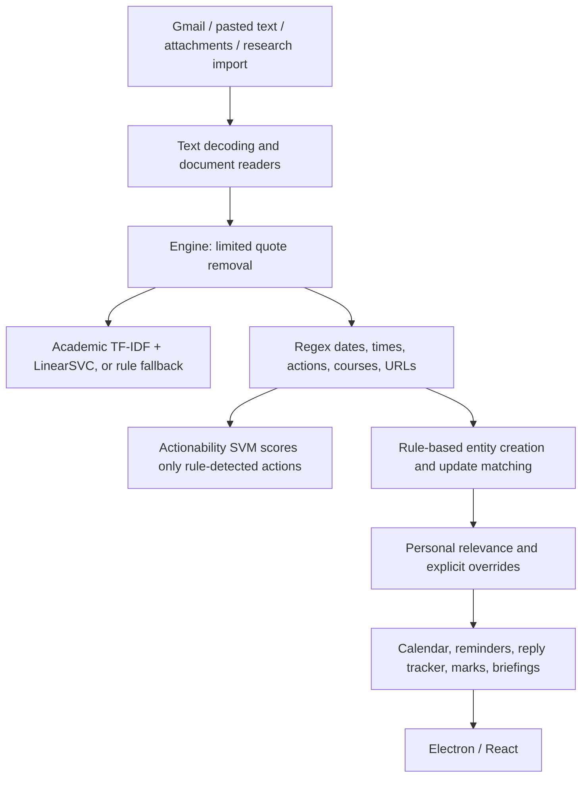

# Campus Mail: ML robustness review and implementation plan

Review date: 25 October 2026. Source revision: `969143d`. Scope: the 80 tracked files in this checkout, with a file-by-file inventory in [CODEBASE_REVIEW_INVENTORY.md](CODEBASE_REVIEW_INVENTORY.md). This is an engineering plan, not a claim that the proposed improvements have been implemented or measured.

The dataset, trained artifacts, local virtual environment, and installed desktop dependencies are absent here. Dataset counts below come from repository documentation; they were not independently recounted. No private data was downloaded, no training was performed, and no application source was modified during this review.

## 1. Principal engineering assessment

Keep the Python modular monolith, local inference, owner isolation, evidence links, and explicit user corrections. Improve the pipeline in this order:

1. Make development and evaluation reproducible without the private archive.
2. Establish reviewed labels, valid leakage groups, and a stable benchmark.
3. Fix extraction and entity-update errors that can produce wrong obligations.
4. Improve the inexpensive supervised baselines and confidence handling.
5. Compare a small semantic encoder and SetFit against those baselines.
6. Add more expensive extraction/OCR techniques only where measured errors justify them.

The central issue is **pipeline correctness and data quality**, not simply classifier accuracy. Improving the academic category model will not directly fix most deadline, cancellation, calendar, or reply-state failures: those paths currently depend primarily on rules.

The architecture already contains useful foundations: TF-IDF is fit inside a training-only pipeline, exact duplicates are grouped, weak-label results are clearly disclosed, unsupported documents retain a status, marks require confirmed identity, and operational feedback stays personal. Preserve these properties.

## 2. What actually runs today



The category is stored in analysis. It does not gate all assignment/event extraction, which is appropriate for multi-topic mail. However, the actionability prediction is currently additional metadata; it neither discovers missed sentences nor drives a validated action decision. `evaluate_extraction()` calls `nlp.analyze()` directly, so its scores do not measure the complete deployed engine, reconciliation, attachments, or model-assisted action path.

### Recorded baseline, with its actual limitations

| Task | Checked-in result | Interpretation |
|---|---:|---|
| Academic SVM | Accuracy 0.512; macro-F1 0.481 | 438 source-labeled records; not gold accuracy |
| Academic NB | Accuracy 0.339; macro-F1 0.226 | Same preliminary task |
| Academic majority | Accuracy 0.157; macro-F1 0.034 | Reported held-out baseline |
| Public actionability SVM | Accuracy 0.817; macro-F1 0.802 | 3,655 corporate-domain sentences; not campus action accuracy |
| Date spans | Precision 0.839; recall 0.222; F1 0.351 | Weak-label agreement on 439 documents |
| Action spans | Precision 0.409; recall 0.180; F1 0.250 | Same weak-label evaluation |
| Date-role accuracy | 0.243 | Conditional on correctly matched date spans |
| Date normalization accuracy | 0.992 | Conditional on matched spans with normalized reference labels |

Source: [PRELIMINARY_RESULTS.md](PRELIMINARY_RESULTS.md). Zero extraction documents were marked human-reviewed. High conditional normalization accuracy does not mean that 99.2% of real deadlines are correctly captured. Missing annotations, span conventions, or label errors may also contribute to low measured extraction scores; inspect errors before attributing all loss to the model.

### Verification on this Mac

`python3 -m pytest -q`: **66 passed, 3 failed**, 69 collected. `node --test desktop/tests/security.test.cjs`: **2 passed**.

| Failure | Observed cause | Required response |
|---|---|---|
| `test_phase0.py::test_dataset_consolidation` | Assumes ignored private JSONL files exist | Separate private-data checks from portable default tests |
| Training split test in `test_phase1.py` | Global SciPy 1.18.0 imports against NumPy 1.26.4; missing `numpy.long` | Create an isolated compatible environment; do not patch NumPy to hide this |
| Settings/connections test in `test_phase9.py` | `keyring` not installed | Install declared dependencies; inject fake vaults in unit tests |

This run used global Python 3.14.6, scikit-learn 1.9.0, FastAPI 0.139.0, Pydantic 2.13.4 and pytest 9.1.1, not the project's pinned environment. It is an environment diagnostic, not a clean reproducibility certificate. Frontend build, Electron workflow, packaged runtime, and real-data metrics were not rerun.

## 3. Highest-priority findings

### P0: correctness and valid measurement

**F1 — No independently reviewed benchmark.** `training.py` accepts source labels; `evaluation.py` trusts a single `human_reviewed` flag. Missing annotation arrays are treated as empty gold sets. Invalid offsets are silently omitted. Introduce task-specific annotation completeness and validation; distinguish “not annotated” from “reviewed and no entities.” Quarantine bad annotations and report counts.

**F2 — Split protection is incomplete.** `training.py:8` chooses one of leakage group, duplicate group, or thread rather than preserving every relation. Training unions that chosen group with exact normalized duplicate text. It does not independently union thread, template, parent attachment, source notice, and update-family links. A single `GroupShuffleSplit` gives no class-support guarantee and there is no validation/calibration split. Preserve all identities and build connected components before splitting; audit giant components and conflicting duplicate labels.

**F3 — Actionability cannot increase candidate recall.** `engine.py:228` predicts only on actions found by regex. Run a supervised detector over all eligible authored sentences/clauses, with contextual features. Keep action detection, actor ownership, requiredness, completion, and reply-state decisions distinct.

**F4 — Cancellation scope is wrong for multiple assignments.** `engine.py:485` applies any occurrence of “cancelled” in the entire text to each assignment. Reproduced with “NLP201 Assignment 1 is cancelled. NLP201 Assignment 2 must submit by 25 October 2026.” Both become cancelled. Resolve the cancellation relation to its target entity before mutating status.

**F5 — Update identity is underspecified.** Assignment keys omit term/semester; unknown-course numbered assignments can collide. Event update matching uses title/course/date heuristics. Reproduced: two Python Workshop occurrences followed by a same-thread reschedule to a third date leave three active events. Ambiguous updates with a date do not take the existing no-date review branch. Match using occurrence identity, thread, source references, course, term, and explicit update relations; abstain when the target is unclear.

**F6 — Dates and times have silent coverage gaps.** `nlp.py:30` misses month-first dates; `nlp.py:103` parses 24-hour times only if no AM/PM times exist anywhere. Reproduced: “Submit the assignment by October 25, 2026.” returns no dates and `needs_review=False`; a document containing 10 AM and 17:00 returns only 10 AM. Detect unsupported temporal cues and make uncertainty visible; parse supported time formats independently and deduplicate overlapping matches.

**F7 — Sentence boundaries and negation are too coarse.** `nlp.py:54` splits at periods in URLs/abbreviations. Reproduced: “Please upload at https://example.edu/form by 25 October 2026.” yields a truncated action ending at `example.` and an unknown date role. “You have already registered, but must upload your ID by 25 October 2026.” yields no action because `already` suppresses the whole sentence. Preserve offset mappings and use clause-level scope.

**F8 — Runtime and research processing differ.** Training concatenates subject and full text; runtime first removes some quoted history. Extraction evaluation bypasses `Engine`. Attachment content analysis uses `analyze()` without the parent's source date or configured classifier; attachment messages are processed through other paths as well. Define one versioned preprocessing contract and explicitly evaluate component and full-pipeline behavior.

### P1: reliability before advanced models

**F9 — Confidence and model provenance are absent.** `nlp.py` calls `predict()` with no calibrated confidence, rejection policy, or taxonomy check. Missing artifacts switch to rules; corrupt/incompatible artifacts can raise at runtime. Add artifact compatibility validation, visible model health, rules-only mode, field-level evidence, and analysis versioning. Never label an SVM margin as a probability.

**F10 — Reconciliation is not uniform across entities.** Assignments explicitly reapply all stored overrides; events do not use an equivalent generic override loop, so fields such as user-corrected event dates/status need regression coverage and a shared reconciliation policy. A later informational message also advances `latest_source_at` even when it asserts no new deadline. Track timestamps/provenance per field, not only per record.

**F11 — Attachment identity conflates content and occurrence.** `engine.py:199` keys the analysis message only by blob hash. Identical attachments under different parents can overwrite the child message's parent/date/subject context. Deduplicate bytes, but keep a distinct parent-specific attachment occurrence and contextual analysis.

**F12 — Evidence is not preserved through every transformation.** Raw text exists, but page locators do not form a universal character-offset map; DOCX tables are appended after paragraphs, and HTML table boundaries can collapse. Subject-only dates are not extracted. Canonicalize body, subject and attachment blocks separately, retaining source field/page/row/cell mappings.

**F13 — Huge-data paths are not streaming.** `training.load_rows()` and `ingestion.import_dataset()` read entire files. Import namespace is derived from the machine-specific absolute path. Repeated `store.list()` calls inside entity loops cause scaling costs. Add streaming validation/import, stable dataset IDs, bounded queries, indexes and profiling. This matters for collaboration even if initial training data is small.

**F14 — Reply-state semantics remain heuristic.** `trackers.py` uses a few request patterns, keyword overlap and acknowledgments. It does not consume the trained actionability model. Sorting uses timestamp strings rather than normalized instants. Use temporal thread snapshots, actor labels, explicit unresolved requests and cautious resolution matching; a shared noun is not proof of completion.

**F15 — Cross-platform verification is incomplete.** The Linux lock is not used by setup scripts. The Playwright test hardcodes `.venv/bin/python`, unlike the Windows launcher. Schema definitions are duplicated in Python, JSON and prompt text. The frontend's `today()` is hardcoded to Asia/Kolkata even when the profile timezone differs. Add platform-specific environment checks, generated-schema checks and timezone-consistent UI tests.

**F16 — Supporting outputs need their own quality gates.** Summary validation checks numeric token membership, which does not prove a date or factual relation is preserved. External all-day calendar imports drop the end date, so multi-day occupancy needs coverage. Job handlers can exceed a fixed lease; multi-record extraction is not one transaction. These can undermine user-visible reliability even with correct ML predictions.

## 4. Work across Windows and Mac without copying the archive

The repository describes 575 scoped documents, 438 eligible academic training rows, 8,292 broader alternative records, and 3,655 public actionability sentences. The 2.79 GB university archive is a separate quarantined source, not a prerequisite for training the existing models. File size and usable labeled examples are different quantities.

| Data/product | Friend's Windows machine | Your Mac | Git |
|---|---|---|---|
| Original mailbox/PDF archive and identity mappings | Retain privately | Not needed initially | Never |
| Sanitized development examples with reviewed labels | Export complete development groups | Small private development pack | Only fabricated/public-safe fixtures by default |
| Full designated research text | Train/evaluate locally | Optional selective transfer later | Private versioned storage |
| Sealed evaluation set | Retain with designated evaluator | No routine tuning access | Manifest/hash only, if safe |
| Run configs, validators, annotation guide, split algorithm | Shared | Shared | Yes |
| Models and reports | Produce versioned bundles | Validate and run inference | Private artifact storage; aggregate reports may be committed |

Ask your teammate for a **development handoff**, not the complete archive:

1. Dataset manifest: actual counts, source counts, bytes, text lengths, per-class support, independent groups per class, label provenance, annotation completeness and missing fields.
2. A sanitized development sample of roughly 100–200 records if available, selected as complete groups across categories and difficult cases. Keep it outside the sealed evaluation set. It is not a representative benchmark by itself.
3. A small attachment fixture pack: readable PDF, scanned PDF, table, multi-page notice, corrupt/encrypted input, and matching body/attachment examples. Share only safe or fabricated fixtures.
4. Existing `metrics.json`, model artifacts, environment versions, source commit and checksums, plus source/annotation manifests. Review vocabulary/artifacts for private information before sharing.
5. A hardware summary: CPU, RAM, free disk, GPU model/VRAM if any. Do not assume that Windows implies CUDA availability or that a Mac has usable MPS support for every operation.

Use a project-wide Python minor version with tested dependencies; Python 3.12 is a reasonable candidate to validate first, not a claim that the existing pins have been tested here. Keep per-platform locks where necessary and explicitly include timezone data for Windows. Never copy a Windows virtual environment or executable onto macOS.

Proposed CLI, **not implemented yet**:

```text
campusmail doctor
campusmail dataset validate --input PATH --report OUTPUT
campusmail dataset export-dev --input PATH --split DEVELOPMENT_MANIFEST --output PATH
campusmail train --task academic --data PATH --config CONFIG --output RUN_DIR
campusmail evaluate --run RUN_DIR --split SEALED_MANIFEST
campusmail models verify --bundle PATH
```

The full-data owner runs the same committed configs and returns aggregate metrics and sanitized development errors. Avoid repeatedly requesting detailed sealed-test errors: that turns the test into a tuning set. A private file share with manifests/checksums is enough initially; introduce DVC only if dataset/version management becomes difficult.

## 5. Benchmark and annotation design

### Task contracts

Keep the existing eight primary categories for comparability. Retain secondary categories separately. Introduce multi-label prediction only after secondary-label completeness and enough support exist. “Unknown model confidence” is a prediction state, not an extra semantic category; `nonacademic_other` must have actual negative examples.

Add a versioned research schema containing dataset/document IDs, source identity, source timestamp/timezone, raw-to-canonical mapping, thread/parent/template/update-family IDs, label provenance, per-task review status, reviewer IDs, adjudication status, completeness flags, and evidence spans. Enforce labels and `text[start:end]` equality. Never overwrite the original export during validation.

For actions, annotate detection, actor, action type, modality/requiredness, completion/negation and linked deadline separately. For dates, annotate span, role, normalized value, precision, timezone, reference and target entity. For thread state, annotate at a defined observation cutoff; later replies cannot be input when evaluating earlier predictions.

### Annotation allocation

Start with a 40–60 document pilot, double-annotated independently, to resolve ambiguity in the guide. Review classification labels across the current small scoped collection if feasible. Deep extraction annotations take longer: initially target 150–250 varied documents, including negative examples, multiple dates, quotations, revisions, tables, and missing context. These are work targets, subject to actual eligible group counts.

Separate development annotation from a sealed reviewed test. Double-annotate the test where feasible, adjudicate disagreements and report class agreement plus span/role agreement. Do not let annotators copy model outputs as gold without independent verification. Exclude uncertain/incomplete fields from the relevant metric with explicit counts, rather than silently scoring them as negatives.

### Split protocol

1. Build leakage connected components from all known relations: thread, exact/near duplicate, template family, parent attachments, same notice/entity update family. Namespace source IDs to avoid cross-corpus collisions.
2. Flag conflicting labels within duplicate groups. Audit similarity thresholds and over-connected groups; common words alone do not establish a duplicate family.
3. Freeze a group-disjoint test of approximately 20–25% **only if** remaining class/group counts support meaningful training and evaluation. Report absent classes and group counts. Do not keep trying seeds until a flattering split appears.
4. Within development data, use 3-fold group-aware stratification where feasible; reduce folds when independent class groups are insufficient. Fit vocabulary, feature selection, models and calibrators strictly inside the relevant training folds.
5. Generate group-disjoint out-of-fold development predictions for model comparison and threshold design. For calibrated evaluation, calibration must itself be nested inside each outer training fold; no row or related group may calibrate its own outer prediction.
6. Once models and policies are frozen, evaluate the sealed test once for release reporting. Changes made after seeing test errors require a new future holdout or disclosure that the old set is now development data.
7. Add a forward-time audit and, when sources permit, a held-out institution/source audit. Purge or explicitly handle families spanning the temporal cutoff. Do not describe a random group split as future generalization.

With only 438 labeled rows, eight-class estimates will be noisy. Use group-level bootstrap confidence intervals, per-class supports, learning curves, and paired model comparisons on identical splits. Do not claim institutional generalization from one mailbox. The existing repeatedly exposed results remain a historical baseline, not a new sealed test.

### Metrics that reflect the product

| Layer | Main measures |
|---|---|
| Category | Macro-F1, per-class precision/recall/F1, confusion matrix; accuracy secondary |
| Actions | Span/sentence F1; required-action recall; actor and status correctness |
| Dates | Strict span F1; diagnostic overlap F1 with one-to-one matching; role-aware F1 |
| Deadline tuples | Correct entity + role + normalized date/time + precision; count missing and spurious tuples |
| Linking/updates | Link precision/recall; false merges; duplicate entities; wrong cancellation/reschedule rate |
| Reply state | Per-request precision/recall at time cutoff; false-resolution rate |
| Personal policy | Missed applicable obligations, mistaken suppression, review volume and correction rate |
| Confidence | Reliability plots, Brier/log loss where probabilities exist, risk versus coverage |
| Operations | p50/p95 latency, memory, parsing failure rates, queue recovery, deterministic replay |

Conditional date normalization remains useful diagnostically, but the main extraction metric must count missed dates and wrong entity links. Report both raw extractor quality and final policy quality: abstention must not hide failures by reducing coverage without disclosure.

## 6. Model selection and experiments

### Stage A: stronger sparse baselines

Retain majority, existing NB and SVM as reference runs. Compare:

| Candidate | Features | Role |
|---|---|---|
| LinearSVC | Word TF-IDF (1–2 grams) + character `char_wb` TF-IDF (3–5 grams) | First deployment challenger |
| Logistic regression | Same feature union | Probabilistic linear comparison; still check calibration |
| ComplementNB | Nonnegative TF-IDF | Imbalance-oriented lightweight comparison |

Separate subject/body channels and tune subject weighting on development folds. Preserve negation, course identifiers, numbers and temporal wording. Normalize boilerplate/quote blocks consistently, with optional masking of volatile tracking IDs and placeholders. Ablate masking: unique sanitized IDs can become label shortcuts, but aggressively removing course information can lose useful evidence.

Use a bounded search, for example `C ∈ {0.1, 1, 10}`, `min_df ∈ {1, 2}`, `class_weight ∈ {None, balanced}`, and a small number of feature/channel variants. Compare a budgeted subset rather than a huge Cartesian search on a tiny dataset. Weighting is an experiment, not an automatic improvement. Avoid SMOTE on sparse text; augmentation must remain within training groups.

Inspect errors by class/source/length/template, then decide whether the next investment is labels, segmentation, features or semantics. Record every experiment, including negative results.

### Stage B: semantic challengers

1. Frozen `sentence-transformers/all-MiniLM-L6-v2` embeddings + logistic regression.
2. SetFit using a small sentence encoder, trained only on development training folds.
3. Only if these plateau and reviewed labels/hardware justify it: a compact fine-tuned sequence classifier or a larger encoder such as DeBERTa, selected through the same evaluation protocol.

MiniLM is an English embedding model, not an out-of-the-box campus classifier. Its model card describes 384-dimensional embeddings and default truncation beyond 256 word pieces. Segment long documents into sentence/paragraph blocks, preserve subject features, and tune pooling on development data; do not silently use just the first block. [MiniLM model card](https://huggingface.co/sentence-transformers/all-MiniLM-L6-v2).

SetFit is a relevant few-shot experiment, not a promised winner on noisy campus labels. Generate contrastive pairs only from the training portion of each fold and preserve original-example split boundaries. Use the official training workflow and pin the tested release. [SetFit documentation](https://huggingface.co/docs/setfit/index).

For multilingual notices, first quantify demand and annotate a separate slice. Compare a multilingual encoder and appropriate OCR on that slice before enabling support. Do not represent an English-only baseline as multilingual.

### Stage C: confidence and abstention

Compare sigmoid calibration for SVM with the logistic baseline, using independent/group-aware calibration data; isotonic calibration is likely data-hungry for the current sample, so treat it as a later experiment. Calibration mappings and preprocessing must be learned without the evaluated groups. [scikit-learn calibration documentation](https://scikit-learn.org/stable/modules/calibration.html).

Choose per-task thresholds on development data according to error costs and review capacity. Example policy: a high-confidence category can be displayed automatically; uncertain categories show a review state; automatic deadline mutations additionally require valid evidence, resolved entity identity, unambiguous date/time and no conflicting assertion. No single confidence cutoff establishes that a calendar mutation is safe.

Measure low vocabulary coverage, unsupported language, unusual length, low semantic similarity to training examples and model disagreement as shift indicators. None is a reliable out-of-distribution detector by itself; evaluate novel-topic and nonacademic negatives. Keep deterministic rules as an explicit fallback and record which path produced each result.

## 7. Extraction and reconciliation design

Split `nlp.py`/`engine.py` incrementally behind compatibility adapters; do not rewrite the entire application at once.

```text
canonical document blocks with source offsets
  -> broad sentence/temporal/entity candidate generation
  -> learned action / temporal-role / entity-relation scoring
  -> deterministic date normalization and invariant validation
  -> field assertions with evidence and uncertainty
  -> entity resolution and explicit update relations
  -> personal policy / user review
  -> transactionally applied records and downstream updates
```

Proposed modules: `preprocessing.py`, `contracts.py`, `classification.py`, `action_detection.py`, `temporal.py`, `linking.py`, `reconciliation.py`, `model_registry.py`, and a research package for validation/splits/experiments. Keep `Application` as the orchestration boundary and `Engine.process()` as the initial public compatibility entry point.

Every candidate should carry document ID, source field, span, exact evidence, optional page/row locator, proposed value, method/version, uncertainty reason, and calibrated score only where available. Each committed field should retain its winning assertion and conflicting alternatives. Version the candidate schema and migration path for existing stored records.

**Text and document handling:** preserve canonical text and source maps; identify authored/quoted/signature blocks without discarding history needed for updates. Improve URL/abbreviation-aware segmentation. Preserve HTML table cells and DOCX paragraph/table order. Assess PDF extraction quality instead of treating every nonempty result as reliable. OCR should be optional, bounded by page/time/memory budgets, and retain bounding boxes/confidence. Evaluate a local OCR adapter on scanned fixtures before choosing its implementation.

**Actions:** score all eligible authored sentences or clauses. Use subject, neighboring sentence, recipient role, and quote status as context. Train campus-specific labels in addition to the separate public baseline. Keep completed/negated/optional/required distinctions. A corporate actionability score must not by itself create a compulsory assignment or mark a request resolved.

**Dates:** independently detect supported forms including month-first, ordinals, date/time ranges, AM/PM and 24-hour times. Anchor relative language to the original source timestamp in the appropriate timezone; never use import time as the date of a historical notice. Keep absent year/time unresolved unless an explicitly documented contextual rule supplies it with evidence. Treat time-before-date, multiple dates and deadlines versus event dates separately. A date parser is a normalization tool, not a role/ownership model.

**Temporal roles and links:** start with a small supervised candidate classifier over marked date/context spans, then compare learned span/relation extraction once reviewed data exists. Link action-date-entity tuples using local syntax, section/table structure and entity identity. Use NER/GLiNER or transformer span models only as measured challengers; generic entity detection does not solve temporal normalization or correction scope.

**Entity updates:** incorporate course, academic term, assignment number, thread, parent attachment, title and explicit references. Semantic similarity retrieves candidates; it does not authorize a merge. Represent `updates`, `cancels`, `corrects`, `supports` and `candidate_supersedes` separately. Preserve user overrides and historical evidence. Test replay in multiple message orders and protect against stale fields, not merely stale records.

**Downstream decisions:** separate extracted fact, academic relevance, student applicability, participation and priority. A deadline can be real but unrelated to the student. Missing evidence should create a review need, not an invented value. Marks keep exact identity matching and deterministic validation. Calendar/reminder changes consume validated current assertions, and rollback restores the prior derived state.

## 8. Advanced techniques, in priority order

| Technique | Use when | Guardrail |
|---|---|---|
| Active learning | Label budget is limited | Select uncertain/disagreed examples plus diversity and random audit samples; avoid evaluating only uncertainty samples |
| Weak supervision | Several useful rules/heuristics exist | Record abstentions, conflicts and coverage; correlated rules are not independent votes; evaluate against reviewed gold |
| Domain adaptation | Corporate action model fails on campus language | Train/adapt on reviewed campus examples; report source-specific results |
| Sparse + semantic ensemble | Models make complementary errors | Fit blending weights on out-of-fold development predictions; calibrate and measure latency |
| Teacher-assisted annotation | Human labeling needs acceleration | Teacher output is provisional; human adjudication; never auto-generate gold test labels |
| Pseudo-labeling | Unlabeled permitted development corpus is available | High-precision selection, class caps, provenance and ablation; exclude test/near-duplicate families |
| Distillation / quantization | A larger proven teacher improves results but is too slow | Compare the exported student against the teacher on the same benchmark; recheck calibration and rare classes |
| Retrieval-assisted extraction | Cross-message context is a measured bottleneck | Retrieve within owner, thread/course and time cutoff; evidence must support each field |
| Conformal prediction sets | A sufficiently large representative calibration set exists | Report empirical coverage and set size; exchangeability assumptions do not guarantee coverage under campus/domain drift |

An LLM fallback can propose schema-constrained candidates for difficult reviewed cases, with exact evidence validation and explicit ambiguity. It should not directly modify deadlines, marks, calendar state or personal identity. If external inference is introduced, it is a new feature with its own data-sharing consent; the current summary configuration authorizes wording, not arbitrary mailbox extraction. Large-model fine-tuning, RAG infrastructure and a vector database are not prerequisites for the first measurable improvement.

## 9. Implementation work packages

Estimates below assume two contributors working part-time and are planning ranges, not commitments. Annotation availability is the critical dependency.

| Order / effort | Deliverable and main files | Acceptance evidence |
|---|---|---|
| WP0 — 1–2 days | Portable setup, `doctor`, fake-vault tests, private-data pytest marker; `pyproject.toml`, setup scripts, CLI, phase0/phase9 tests, desktop test | Clean Mac and Windows tests without private data; research test fails clearly when explicitly requested without data |
| WP1 — 3–5 days plus annotation | Research schema, streaming validator, stable dataset IDs, handoff exporter, annotation guide, group builder | Counts reconcile; invalid spans/enums and duplicate conflicts reported; no relation crosses split boundaries |
| WP2 — 3–5 days | Component + deployed-pipeline evaluators; frozen split manifests; metrics/CI/error reports | Same manifest reproduces results; unannotated fields excluded explicitly; conditional and end-to-end metrics distinguished |
| WP3 — 3–5 days | Candidate contracts, sentence/time fixes, entity-scoped cancellation, occurrence-aware updates, override handling, attachment occurrences | All reproduced defects become regression tests; replay does not cancel unrelated items or leave stale reschedules |
| WP4 — 2–4 days | Sparse experiment runner, feature channels, bounded search, nested calibration and abstention | Compare identical folds; record per-class gains/losses, risk/coverage and resource cost |
| WP5 — 3–6 days | Full-sentence campus action detection, temporal roles and entity-date linking | Improved reviewed action recall and deadline-tuple accuracy without increased wrong automatic updates |
| WP6 — 2–4 days, conditional | Frozen encoder and SetFit experiments; optional ensemble | Promote only if paired evaluation and deployment cost justify it; retain sparse fallback |
| WP7 — 2–4 days | Registry, artifact verification, shadow inference, rollback, UI model/review status, platform packaging | Both OSes agree on reference predictions; artifact failure is visible; overrides and source evidence survive reprocessing |

A realistic first milestone is WP0–WP4 with a modest reviewed dataset. Broader extraction/OCR and semantic model work can extend the project to roughly 4–6 weeks depending on available hours and annotation throughput. Stop adding models when data or reconciliation dominates the remaining errors.

Suggested ownership: you own portable tooling, contracts, evaluation and runtime fixes on the Mac; your teammate owns full-data validation/training and artifact export on Windows. Both independently annotate the pilot and review high-impact errors. One named evaluator controls the sealed test. Review each other's changes; do not divide labels so that one reviewer alone defines all examples of a class.

## 10. Release gates and experiment records

Provisional engineering targets, to be ratified after the reviewed baseline exists:

| Gate | Initial target |
|---|---|
| Category improvement | At least +0.05 absolute macro-F1 over the reproduced baseline on identical reviewed splits; inspect paired uncertainty and every class |
| Required-action detection | Recall at least 0.90, with precision/review volume reported |
| Automatically committed deadline tuples | Precision at least 0.98 at explicitly reported coverage; no unsupported time invention |
| Entity mutations | Zero known wrong-target cancellations, stale reschedules or override losses in the deterministic acceptance suite |
| Evidence validity | 100% of committed extracted fields have valid source references/spans or explicit structured-source locators |
| Review load | Measure reviews per 100 messages; initial usability budget of 20–30, adjustable to real risk |
| Latency | Initial CPU p95 target under 500 ms for short text, excluding network/OCR; benchmark on actual devices |
| Recovery | Same sources/run version replay without duplicate entities or lost confirmed edits; old artifact can be restored |

These are targets, not expected results. A tiny test cannot substantiate a very high precision claim. Report numerator, denominator, independent groups, confidence interval and coverage; zero observed errors does not imply zero real-world risk. Keep high-impact cases in review until sufficient evidence supports automation.

Each run should save: run ID, source commit, dataset/annotation/split hashes, source counts, schema/preprocessing versions, random seeds, config, all dependency versions, OS/hardware, model revision/license, fitted parameters, predictions and evidence on permitted evaluation data, metrics by slice, calibration/threshold config, latency/memory, and artifact checksum. Prediction-level outputs containing private text stay in private storage.

Use immutable run directories rather than overwriting `classifier.joblib` during experiments. Promote a verified bundle through a manifest pointer with atomic replacement and a rollback pointer. Validate taxonomy, feature contract and dependency compatibility before loading. Load pickle/joblib artifacts only from trusted team sources: these formats can execute code, and cross-version scikit-learn loading is unsupported. [scikit-learn model persistence](https://scikit-learn.org/stable/model_persistence.html).

Run a challenger in shadow mode against development or explicitly designated pilot inputs: record candidates and disagreements without mutating live records. Reprocessing should be versioned and review changed high-impact fields. Monitor source mix, unreadable documents, missing-model status, abstention, correction rate, novel course codes, and latency; drift signals trigger review, not automatic retraining on private operational feedback.

## 11. First ten concrete tasks

1. Establish the shared Python environment and a clean baseline run on both machines.
2. Move the private-dataset existence assertion out of the default test suite and add a real fixture-backed data-contract test.
3. Obtain the manifest and small development handoff; leave the large archive on Windows.
4. Validate and independently review the pilot labels before choosing a new model.
5. Preserve all grouping metadata and freeze development/test boundaries.
6. Add regression cases for the six reproduced parser/reconciliation failures in this review.
7. Introduce typed extraction candidates and field-level provenance behind the existing engine interface.
8. Implement the sparse baseline experiment matrix and group-aware evaluation/calibration.
9. Run the action detector across all eligible authored sentences and evaluate campus action/actor/status labels.
10. Compare the frozen semantic encoder and SetFit only after the preceding benchmark and correctness work is stable.

## 12. Primary references checked

Recommendations above are project-specific engineering judgments; external documentation supports technique/API behavior, not predicted accuracy on this absent dataset.

- [scikit-learn group-aware cross-validation](https://scikit-learn.org/stable/modules/cross_validation.html): use group-aware evaluation and inspect class support.
- [scikit-learn probability calibration](https://scikit-learn.org/stable/modules/calibration.html): calibration needs appropriately independent fitting/evaluation data.
- [scikit-learn model persistence](https://scikit-learn.org/stable/model_persistence.html): trusted artifacts and compatible environments matter.
- [MiniLM model card](https://huggingface.co/sentence-transformers/all-MiniLM-L6-v2): embedding model characteristics and input limits.
- [SetFit documentation](https://huggingface.co/docs/setfit/index) and [original SetFit paper](https://arxiv.org/abs/2209.11055): few-shot sentence-encoder fine-tuning as an experimental candidate.

The consulted stable documentation may be newer than the project's scikit-learn 1.7.2 pin. Implement against the deliberately selected and tested version; do not copy newer API examples without compatibility checks.
